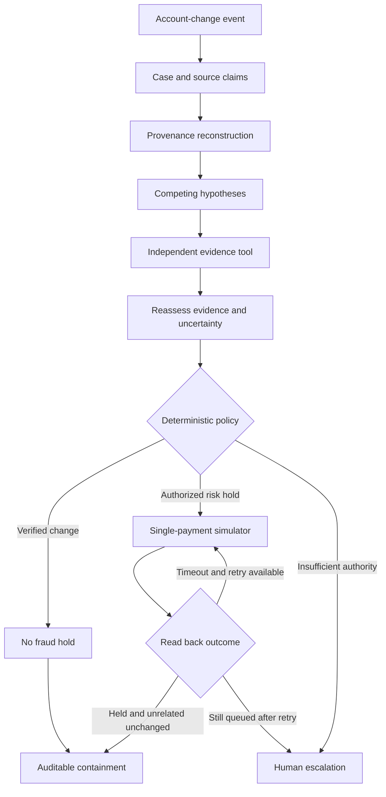

# Architecture

## Execution, not replay

A synthetic event enters through `POST /api/events` or the simulation endpoint. Its external event ID is deduplicated inside the user's durable workspace. `consumeEvent()` opens a case automatically; the client never sends a chat instruction to an investigator.

The six roles operate real implemented local tools:

| Role | Tools and responsibility |
|---|---|
| Event Sentinel | Inspect changed account; create a case from an event |
| Evidence Provenance Investigator | Reconcile source values; extract claims; recursively trace dependencies |
| Financial Investigation Reasoner | Open competing hypotheses; choose history vs. signed-approval lookup; revise explanations |
| Independent Verification Agent | Retrieve synthetic signed contract / pre-established contact evidence |
| Containment Planner | Evaluate deterministic hold policy; invoke the mock queue with an idempotency key |
| Outcome Verification & Audit Agent | Read payment state, retry once when appropriate, compare unrelated payments, finalize report |

The reasoner revisits hypotheses after independent evidence arrives. A confirmed legitimate update contradicts the compromise hypothesis; absence of evidence produces uncertainty. A new account alone is never sufficient to assert fraud.

## Persistence and concurrency

Hosted state is a JSON aggregate in D1, keyed by the authenticated Site user. The aggregate is a transaction boundary for case, evidence, policy, and simulated payment state. Each mutation uses an expected revision and a random mutation token. The payment snapshot and fresh audit events are committed in one D1 batch. Audit inserts are conditional on the winning mutation token, so losing concurrent writers cannot append receipts for actions they did not commit. SQL triggers reject audit updates and deletes.

FastAPI uses SQLAlchemy with the same snapshot / optimistic-version structure, an immutable audit table, and a normalized domain projection. `backend/models.py` declares all requested domain entities. Claims include the full provenance and integrity fields. The first migration is provided for SQLite and PostgreSQL; startup applies the current schema for this prototype. Use a reviewed migration system for future production schema changes.

The domain projection includes organizations, suppliers, trusted_supplier_contacts, bank_accounts, purchase_orders, invoices, invoice_line_items, approval_events, account_change_events, payments, payment_batches, source_documents, evidence_claims, evidence_dependencies, investigation_cases, agent_runs, agent_tool_calls, hypotheses, verification_requests, policy_decisions, containment_actions, audit_events, and users_and_roles. Core investigation/payment/evidence entities are projected from executions. Procurement entities without input documents remain empty rather than containing fabricated business data.

Tenant identity is bound by the authenticated transport, not chosen by an agent tool. The hosted aggregate prevents cross-tenant case reads. FastAPI query helpers require the server's Principal. A production SQL deployment must also restrict database roles and add RLS if multiple application roles receive direct database access.

## Streaming and stopping

The hosted response streams full saved snapshots as SSE. It performs one tool stage per transition with 550 ms presentation pacing. The measured end-to-end demo duration includes this pacing; tool receipt times and evaluation measurements do not. The portable API uses 200 ms pacing for its SSE transport and no pacing for event ingestion.

A run has 13 bounded stages, a 60-second deadline, and at most two hold attempts. The same action key is reused for safe retry. A payment already held is idempotently acknowledged without another action. Explicit human recovery marks interrupted work as escalated after the deadline. There is one active run per workspace to avoid ambiguous simultaneous case mutations. For continuous production operation, replace the request-scoped driver with a durable job runner and lease/heartbeat recovery; this is a known extension point.

## Google Cloud path

Cloud mode in FastAPI requires PostgreSQL. At the independent-evidence checkpoint, six ADK agents perform live advisory investigation with case-scoped read tools and an advisory hold proposal. Their final citations are validated against existing evidence IDs. They cannot call the simulated payment execution or release tools. The authoritative deterministic engine evaluates policy from stored evidence independently of model text.

The included adapters call Gemini, BigQuery, Document AI, Agent Search, Pub/Sub, and GCS when configured. They do not silently fall back to mock responses. The hosted Site has no Google Cloud credentials and reports those services as unconfigured. Native data ingestion into the synthetic fixture model, production identity, durable ADK sessions, and signed-document verification require additional integration work.
