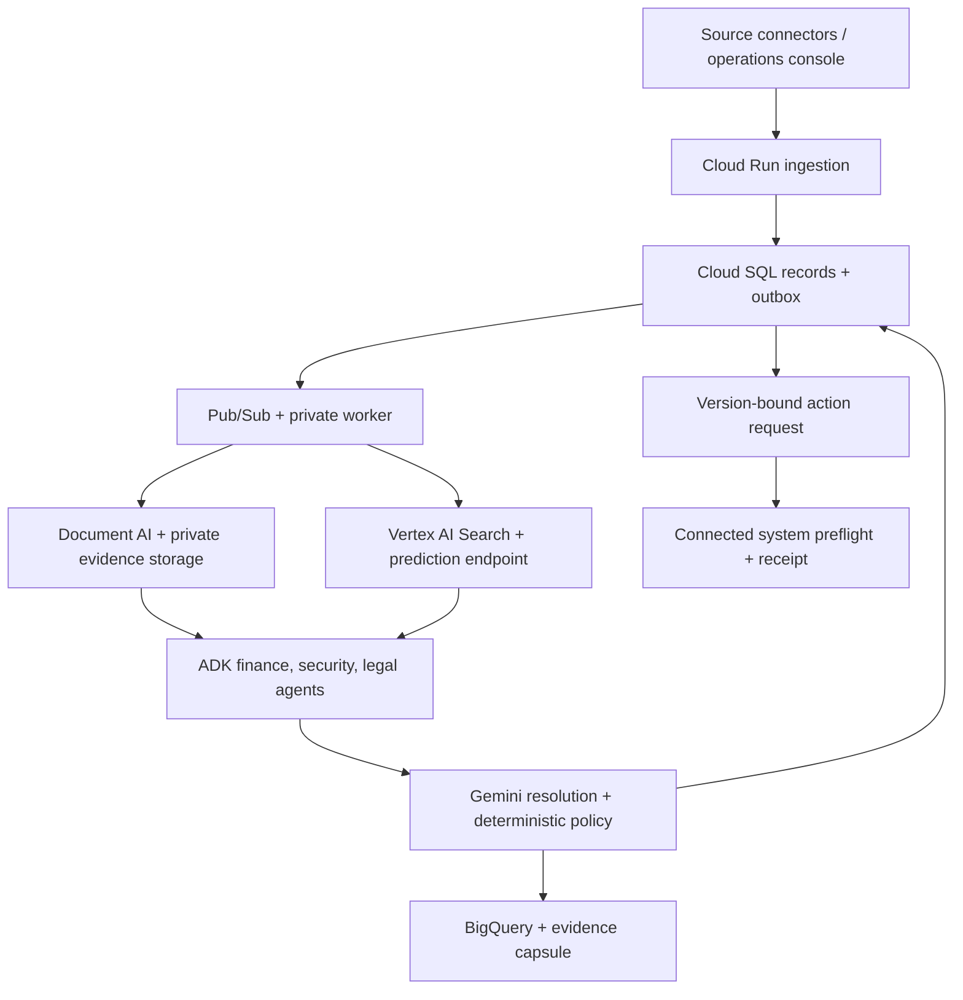

# Evidence-bound operations

TRUESTATE v2 is an event-driven vendor-payment and supplier-change control prototype for finance, security, and legal operations. It is not a general assistant, legal practice system, SIEM, bank, or ERP. The initial concrete workflow is: assess a real supplier payment against supporting documents and organization policies; record a time-limited decision; invalidate and reassess it when its inputs change.

The three specialist agents run in parallel through Google ADK. A fourth reconciles their findings. Skills are actual version-controlled instruction files in `agents/skills`; they are loaded at runtime, not merely listed in documentation. All inference uses Gemini on Vertex AI and Application Default Credentials. Workflow summaries are streamed through persisted SQL events; bounded explanation sections use genuine Gemini token streaming. No general chat endpoint exists.

Managed components are reused directly: Document AI's pretrained OCR processor handles PDFs and images; UTF-8 documents and exported emails use a deterministic decoder; Vertex AI Search indexes approved company policies; Google ADK orchestrates specialists. The predictive endpoint is a separate real Vertex model. A missing endpoint returns `not_configured`, never an invented score. Policies that require predictions cannot automatically clear without one.

One deployment serves one organization. Cloud SQL PostgreSQL stores authoritative records, versions, jobs, inbox idempotency keys, decisions, action requests, receipts, and audit events. Short organization-scoped PostgreSQL advisory locks serialize mutations; network calls occur outside these transactions. Inputs and job creation commit together. A scheduler republishes unsent outbox work and recovers abandoned leases. The worker retries failures up to three claimed attempts; failed jobs remain visible. Pub/Sub also has a retained dead-letter subscription for delivery failures and invalid messages.

Original files are generation-addressed in private Cloud Storage. Reports become immutable-by-key evidence capsules. BigQuery receives idempotent assessment events and aggregates each currency separately. Prediction features include currency so the supplied baseline rejects a currency it was not trained on.

A decision binds transaction contents, document versions and hashes, declared ancestry, connector attestations, the automation policy, and the entire registered policy corpus. Inserting, retiring, or replacing a policy therefore changes the decision's input snapshot even when that policy was not returned by search. Policy registration is distinguished from search readiness; the scheduler checks submitted policies and triggers reassessment when they become retrievable.

The console exposes work queues, evidence provenance, current decisions, configuration, measured analytics, service checks, and receipts. A case can export its actual JSON report. The interface has responsive layouts and keyboard-operable dialogs. The frontend bundles no business-data fixtures. The release seed job now creates 2,000,000 labelled synthetic transactions in PostgreSQL under a reserved synthetic organization. Those rows are shown as unassessed until a real assessment runs. No document evidence, model findings, accuracy or revenue metrics are fabricated. External execution is blocked for synthetic workspaces.

## Release and migration order

GitHub Actions validates source and PostgreSQL behavior, provisions the foundation, builds an immutable image, then applies a separate jobs root. A Cloud SQL backup precedes the Alembic upgrade. Resumable PostgreSQL seeding and runtime-identity service checks must pass before the application/worker root is applied. Startup readiness verifies the packaged Alembic head and the required seed manifest. See [the release configuration](GITHUB_DEPLOYMENT.md) and [migration operations](MIGRATIONS.md).
